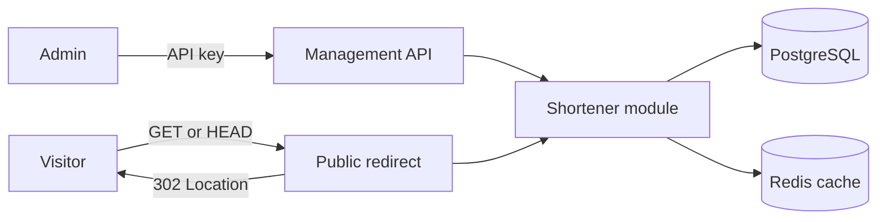

# URL shortener

A Go modular monolith that manages short links and redirects visitors. PostgreSQL stores links; Redis caches public lookups.



## Get started

Install Docker and Docker Compose. Then set up the application and example links:

```sh
make setup
```

The command also starts Prometheus, Grafana and Tempo. Grafana is available at `http://localhost:3000` with the local default login `admin` / `admin`.

The application listens at `http://localhost:8080` by default. Stop the stack with `make docker-down`. For manual startup or host execution with Go 1.27.3, see [operations](docs/operations.md).

## Documentation

- [Operations](docs/operations.md): configuration, local execution, Compose and checks.
- [HTTP API](docs/api.md): authentication, endpoints and curl examples.
- [Architecture](docs/architecture.md): module boundaries and cache consistency.
- [Glossary](GLOSSARY.md): domain terms and their [code locations](GLOSSARY-MAP.md).

Before exposing the application to the internet, configure proxy-level abuse protection. This project does not provide application-level rate limiting or phishing detection.
