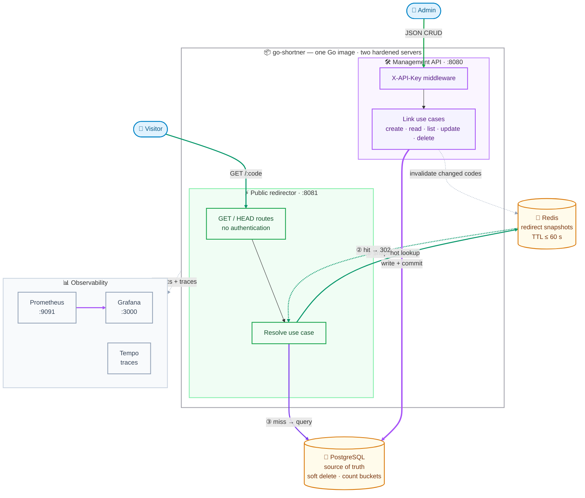
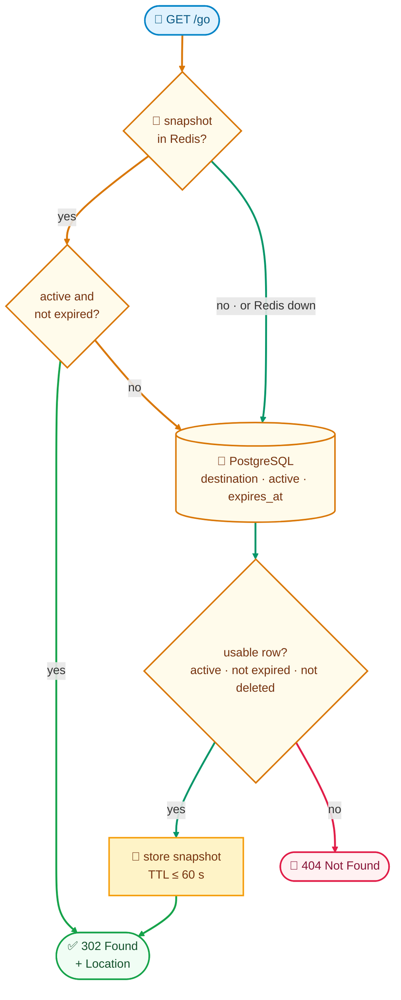

# URL shortener

Go URL shortener with separate management and public servers. PostgreSQL stores links. Redis caches redirects.

## How it works

**Admins** manage links through an authenticated API. **Everyone else** just follows short URLs — the public server turns a code into a `302` redirect and touches nothing else. One image, two hardened Go servers:



How to read it:

- **Admin → Management API (`:8080`)** — JSON CRUD behind an `X-API-Key`. Every write commits to PostgreSQL first, then invalidates the changed code in Redis.
- **Visitor → Public redirector (`:8081`)** — `GET`/`HEAD` only. No key, no management surface.
- **Hot path ① → ② → ③** — the resolver checks the Redis snapshot first, answers `302` on a hit, and only queries PostgreSQL on a miss (or if Redis is down). A changed link can serve stale data for at most 60 seconds.
- **PostgreSQL** — the single source of truth: soft deletes, expiration, active state, and the counters that keep pagination totals exact.
- **Prometheus + Tempo → Grafana** — both servers export metrics and traces on their own listeners.

A single redirect, as a decision flow — every branch ends in either `302` or `404`:



## Run

Requires Docker and Docker Compose.

```sh
make setup
```

| Service | Address |
| --- | --- |
| Management API | http://localhost:8080 |
| Public redirects | http://localhost:8081 |
| Grafana | http://localhost:3000 |

Setup creates credentials, runs migrations and seeds example links. Grafana uses `admin` / `admin`. Stop with `make docker-down`.

## Performance

The mixed workload reached 7,080 requests/s with 2.28 ms p95 and zero HTTP errors. A repeat reached 6,854 requests/s. Both used one million links, 10 virtual users and 2 minutes of closed-loop load. The PostgreSQL pool allows 30 open and 10 idle connections.

The two Go servers have a combined 64 MiB memory limit. Dependencies use additional resources. See [results and Compose limits](docs/performance.md). Sustained arrival-rate capacity remains unverified.

## Documentation

- [Operations](docs/operations.md)
- [HTTP API](docs/api.md)
- [Architecture](docs/architecture.md)
- [Load testing](docs/load-testing.md)
- [Metrics](docs/metrics.md)
- [Glossary](GLOSSARY.md) and [code map](GLOSSARY-MAP.md)

Configure proxy-level abuse protection before internet exposure. The application has no rate limiting or phishing detection.
