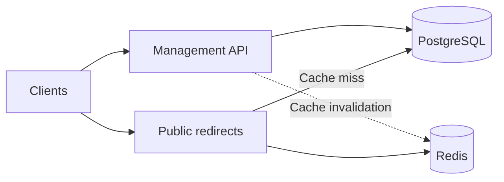
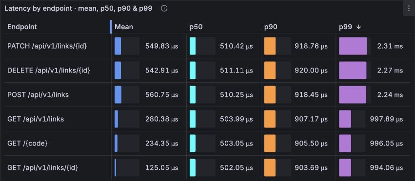
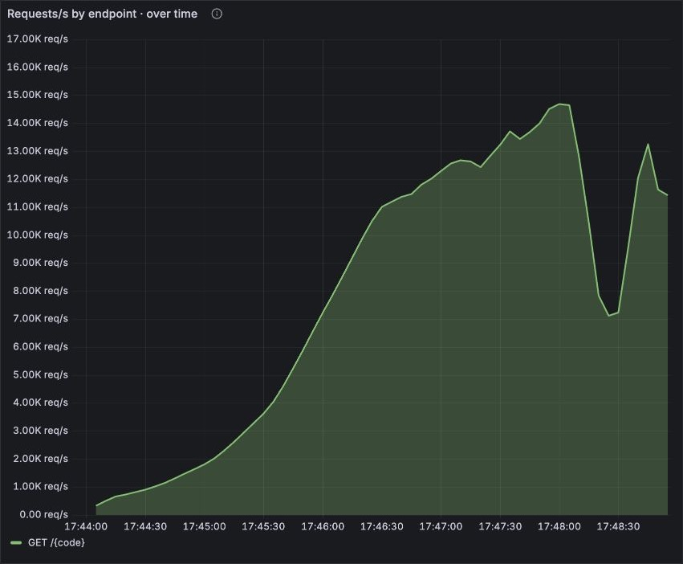

# Go shortener

A URL shortener written in Go. It creates short links, manages their destinations and serves public redirects through a separate HTTP server.

The management API supports generated codes or custom aliases, expiration, activation, updates, soft deletion and pagination with exact totals. Management routes require an API key; public GET and HEAD redirects do not.

PostgreSQL stores links and their lifecycle state. Redis caches public lookups. The application uses Chi for HTTP routing, GORM for persistence, Cobra for commands and Fx for composition. Prometheus, Grafana and Jaeger provide metrics, dashboards and traces.

## Project structure

```text
├── .github/                                             # GitHub automation
│   └── workflows/                                       # Continuous integration workflows
├── cmd/                                                 # Management, public server and migration commands
├── config/                                              # Application configuration by environment
├── docker/                                              # Compose stacks and container configuration
│   ├── load/                                            # Load-stack proxy, seed, telemetry and tracing settings
│   │   └── dashboards/                                  # k6 generator dashboard
│   └── observability/                                   # Application monitoring and datasource provisioning
│       └── dashboards/                                  # Application Grafana dashboard
├── docs/                                                # API, architecture, operations and measurement guides
│   ├── agents/                                          # Repository instructions for development agents
│   ├── assets/                                          # Images used by the documentation
│   └── benchmarks/                                      # Historical benchmark records
├── internal/                                            # Application code private to this Go module
│   ├── modules/                                         # Business modules
│   │   └── shortener/                                   # Link management and public resolution
│   │       ├── cache/                                   # Redis redirect-cache adapter
│   │       ├── errs/                                    # Shortener domain errors
│   │       ├── http/                                    # HTTP transport contracts and adapters
│   │       │   ├── chi/                                 # Chi transport implementation
│   │       │   │   ├── handler/                         # Management and redirect request handlers
│   │       │   │   └── router/                          # Management and public route registration
│   │       │   ├── dto/                                 # HTTP request and response types
│   │       │   └── mapper/                              # Conversion between HTTP and use-case types
│   │       ├── migration/                               # Embedded schema and counter migrations
│   │       ├── model/                                   # Link persistence model
│   │       ├── port/                                    # Repository, cache, generator and validator interfaces
│   │       ├── repository/                              # PostgreSQL link persistence and pagination
│   │       ├── service/                                 # Public code generation
│   │       ├── usecase/                                 # Create, get, list, update, delete and resolve operations
│   │       └── validator/                               # Destination URL validation
│   └── shared/                                          # Infrastructure shared by both servers
│       ├── config/                                      # Configuration loading and validation
│       ├── httpserver/                                  # HTTP servers, API-key middleware and request handling
│       ├── metrics/                                     # Application metric definitions and recording
│       └── migration/                                   # Collection and execution of embedded migrations
├── reports/                                             # Generated local reports; ignored by Git
│   └── load/                                            # Per-run load results, summaries and resource records
│       └── datasets/                                    # Dataset preparation and count reconciliation reports
├── scripts/                                             # Setup, tooling, test runners and diagnostics
│   └── seed/                                            # Local example-link seeding
└── test/                                                # Verification against application interfaces
    ├── e2e/                                             # HTTP end-to-end suite using real dependencies
    │   └── modules/                                     # End-to-end suites grouped by module
    │       └── shortner/                                # Shortener CRUD, pagination and redirect HTTP tests
    ├── integration/                                     # Application and infrastructure integration tests
    │   └── modules/                                     # Integration suites grouped by module
    │       └── shortener/                               # Shortener composition and resource integration tests
    │           └── usecase/                             # Link validation integration tests
    ├── load/                                            # k6 workloads and load-harness verification
    └── migration/                                       # SQL checks for pagination counters and migrations
```

Directories under `reports/load/` are generated per execution; their names vary with each run.

## Architecture



The two servers run as separate processes with their own resource limits and connection pools. Handlers translate HTTP requests; use cases apply link policy; repositories and cache adapters perform storage operations.

PostgreSQL is authoritative. Management writes invalidate the redirect cache after commit. Cached entries retain their original expiry, with a maximum lifetime of 60 seconds; updates can therefore remain stale within that bound. Pagination sums 64 transactional counters for its total and uses the database index for page items.

The load stack adds k6 and Nginx in front of the servers. Nginx keeps upstream connections alive and does not cache responses. See [architecture decisions and tradeoffs](docs/architecture.md) for the details.

## Run locally

Requires Docker and Docker Compose.

```sh
make setup
```

Setup creates local credentials, applies migrations, seeds example links and starts the servers and observability services.

| Service | Address |
| --- | --- |
| Management API | [localhost:8080](http://localhost:8080) |
| Public redirects | [localhost:8081](http://localhost:8081) |
| Grafana | [localhost:3000](http://localhost:3000) |
| Jaeger | [localhost:16686](http://localhost:16686) |

Local Grafana uses `admin` / `admin`. Stop the stack with `make docker-down`; the database volume is preserved.

## Documentation

- [HTTP API and curl examples](docs/api.md)
- [Architecture decisions](docs/architecture.md)
- [Operations](docs/operations.md), [metrics](docs/metrics.md) and [dashboard guide](docs/dashboard.md)
- [Domain glossary](GLOSSARY.md)
- [Load-test commands and result verification](docs/benchmark-reproduction.md)

## Metrics and results — as is

These measurements describe the project **as tested on 2026-11-06**. They are local observations under the conditions below, rather than production SLOs or a general capacity certification. No application optimization was made during these runs.

Each run started from a restored **10,000,000-link baseline**, with reconciled database counts. Traffic passed through Nginx. Application metrics and k6 remote write were active in Prometheus/Grafana, with 10% root-trace sampling.

Both Go servers had **0.5 CPU**, no swap and `GOMAXPROCS=1`. Management and the earlier runs used **32 MiB per server**, with `GOMEMLIMIT=24MiB`. The final public GET run used **64 MiB**, with `GOMEMLIMIT=48MiB`. Database, cache, proxy, generator and monitoring resources are additional. A historical stack remained running on the same Docker VM.

### Isolated management

One five-minute execution per row, offering 1,010 requests/s after 1,000 sequential warmup requests. k6 checked status and response content, with 200 preallocated VUs and a maximum of 1,000. Rates count completions inside the measured window, including failed requests; p99 is client-side latency.

| Scenario | Completed req/s | Client p99 | HTTP failures | Dropped iterations |
| --- | ---: | ---: | ---: | ---: |
| Create | 1,010.00 | 2.43 ms | 0 | 0 |
| Lookup by ID | 1,010.00 | 1.19 ms | 0 | 0 |
| List, page 1 | 1,010.00 | 1.44 ms | 0 | 0 |
| List, page 450,001 | 26.97 | 60.00 s | 8,856 | 293,909 |
| Update | 1,009.99 | 30.75 ms | 0 | 0 |

Deep pagination failed. All 8,856 recorded completions failed, including 765 after the window; another 235 started requests never reported completion. Successful measured throughput was zero. Its sequential warmup took about 13.5 minutes. The other four rows met the isolated gates: at least 1,000 completed req/s, p99 ≤ 100 ms, and zero HTTP errors, failed checks or drops.

### Full API together

One **60-second run at 200 iterations/s**, covering create, get, list, update, public GET, public HEAD and delete: 1,400 offered requests/s in total. Reads target the link created in the same iteration. There was no workload warmup.

| Completed requests | Mean req/s | Client p99 | HTTP errors | Failed checks | Dropped iterations |
| ---: | ---: | ---: | ---: | ---: | ---: |
| 84,007 | 1,399.95 | 1.59 ms | 0 | 0 | 0 |

The mean uses k6's 60.007-second elapsed time, including the final drain. This is the aggregate rate for the stated mix. Deletion is represented in this mixed run.



The application dashboard estimates server-side latency from histogram buckets. k6 measures client latency through the proxy and network. Endpoint panels omit HEAD, although the test includes it.

### Public GET with gradual load

One **five-minute GET-only run**, using 1,000 seeded codes and 1,000 warmup GETs. One GET per iteration, without following external redirects. The offer increased from **500 to 50,000 requests/s** through ten 30-second ramps, with 100 preallocated VUs and a maximum of 200. The public server had **64 MiB and 0.5 CPU**.

| Successful GETs | Mean req/s across the ramp | Client p99 | HTTP errors | Failed checks | Dropped iterations |
| ---: | ---: | ---: | ---: | ---: | ---: |
| 2,448,519 | 8,151.81 | 62.06 ms | 0 | 0 | 2,358,917 |

The highest sampled successful client rate was **14,701.79 req/s over a rolling 20-second window**, sampled every five seconds. The mean uses 300.365 seconds including the final drain. The server stayed up without OOM; sampled CPU reached 0.501 cores, approximately its quota. The offered 50,000 req/s was not sustained: the run failed its zero-drop gate.



This application-dashboard view shows server-observed traffic. Its rolling peak was 14,686.27 req/s; the client-counter peak above is a separate measurement. Both screenshots select their respective run intervals.

### Observed limits

Deep pagination timed out under load. An earlier abrupt GET/HEAD stress, offering 30,000–60,000 req/s with 32 MiB and batches of ten, OOM-killed the public process: 1,243,760 of 1,243,929 recorded requests failed, with 83,898 dropped iterations. The gradual 64-MiB GET run stayed up, but also dropped offered work. These observations point to pagination cost and behavior under redirect concurrency as areas for improvement. They do not independently identify a throughput bottleneck: generator headroom, CPU throttling and dependency waits affect the result.

The historical **27,179 redirects/s** result used one million links, 1 CPU for public traffic, tracing disabled and a different workload. Its original conditions remain in the [historical report](docs/performance.md).

[Reproduce and verify these results](docs/benchmark-reproduction.md) · [Recorded measurements and conditions](docs/management-capacity-10m.json) · [Other load workloads](docs/load-testing.md)
