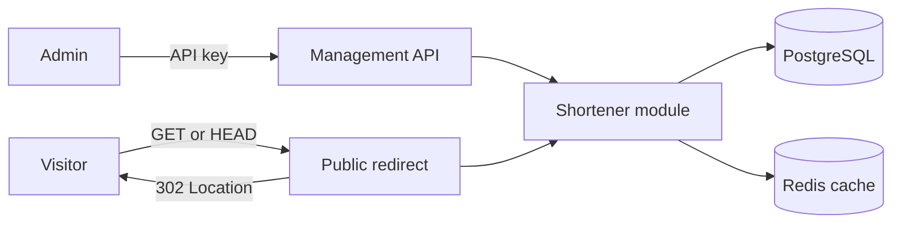

# URL shortener

A Go modular monolith that manages short links and redirects visitors. PostgreSQL stores links; Redis caches public lookups.



## Get started

Install Docker and Docker Compose. Then set up the application and example links:

```sh
make setup
```

The command also starts Prometheus, Grafana and Tempo. Grafana is available at `http://localhost:3000` with the local default login `admin` / `admin`.

The application listens at `http://localhost:8080` by default. Stop the stack with `make docker-down`. For manual startup or host execution with Go 1.27.3, see [operations](docs/operations.md).

## Tracing

Bricks manages the tracing provider through Fx. The supplied `app.open-telemetry` configuration exports OTLP over gRPC to `tempo:4317` on the Compose network. Use an environment-specific YAML file to select another endpoint when running outside Compose. Set `trace_enabled` to `false` to disable export or set `sample_rate` between 0 and 1 to control root sampling. The supplied rate is 1. The exporter uses bounded queues and timeouts, and requests continue when Tempo is unavailable.

The application creates spans for use cases, repository methods and Redis cache methods. It does not create HTTP spans or enable the Bricks GORM and Redis command plugins. Application spans do not contain link data or request payloads. HTTP drains before the tracing provider shuts down. Grafana's Tempo datasource can be used to inspect exported traces. If third-party tracing plugins are enabled in future, their exception and status messages may contain sensitive details even when SQL and argument capture is disabled.

## Documentation

- [Operations](docs/operations.md): configuration, local execution, Compose and checks.
- [Metrics](docs/metrics.md): metric meanings, histogram buckets and series budgets.
- [HTTP API](docs/api.md): authentication, endpoints and curl examples.
- [Architecture](docs/architecture.md): module boundaries and cache consistency.
- [Glossary](GLOSSARY.md): domain terms and their [code locations](GLOSSARY-MAP.md).

Before exposing the application to the internet, configure proxy-level abuse protection. This project does not provide application-level rate limiting or phishing detection.
