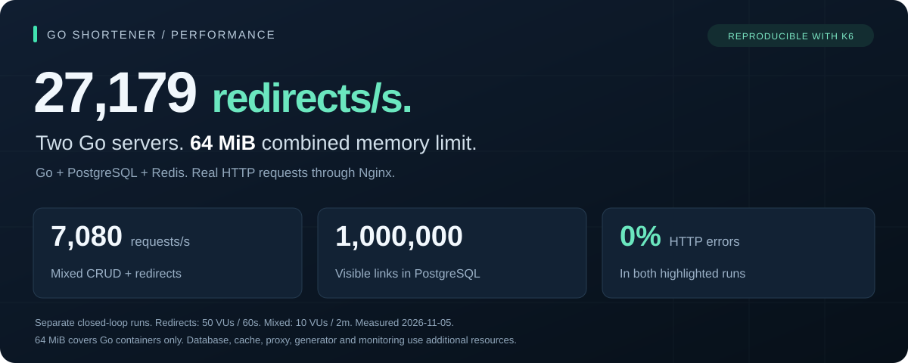
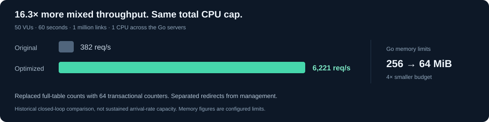
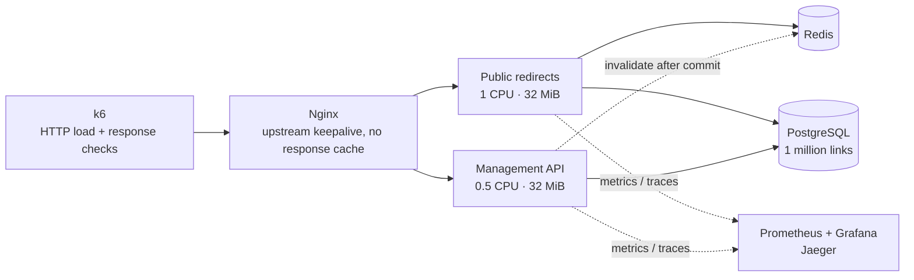

# Go shortener

A Go URL shortener built to measure how much traffic a small backend can handle.



[Results & methodology](docs/performance.md) · [Benchmark data](docs/benchmarks.json) · [Run it](#run-it) · [About the author](https://github.com/cristiano-pacheco)

## The engineering behind the numbers



| Decision | Effect |
| --- | --- |
| Cache redirect snapshots in Redis | A usable cache hit serves a `302` without querying PostgreSQL. |
| Replace full-table counts with 64 transactional counters | Pagination returns exact totals without counting a million rows per request. |
| Run redirects and management in separate Go processes | Each server has its own CPU quota, memory limit and connection pool. |
| Measure HTTP, use cases, cache and database operations | Grafana shows throughput, p99 latency, resource use and pool pressure. Jaeger exposes traces. |

[Architecture & tradeoffs](docs/architecture.md) · [HTTP API](docs/api.md)

## See the system work

Open **Shortener · Performance & efficiency** in Grafana.


Compare throughput and latency by endpoint. Endpoint views omit HEAD requests. Summary cards retain the selected interval's peaks after traffic stops. Expand diagnostic rows to inspect CPU, memory, Redis and PostgreSQL.

[Dashboard & screenshot guide](docs/dashboard.md) · [Metrics](docs/metrics.md) · [Operations](docs/operations.md) · [Glossary](GLOSSARY.md)

## The load-test infrastructure



Docker Compose runs the generator, proxy, application, data stores and monitoring. Each Go container has no swap, `GOMEMLIMIT=24MiB` and `GOMAXPROCS=1`. The 64 MiB budget covers the Go containers. Dependencies and test tooling use additional resources.

| Published scenario | Workload | Observed throughput |
| --- | --- | ---: |
| Redirects | 50 virtual users, 60s, GET/HEAD across 1,000 seeded codes | 27,179 req/s |
| Mixed | 10 virtual users, 2m, create, get, list, update, GET, HEAD, delete | 7,080 req/s |

These are separate historical closed-loop runs with tracing disabled and zero HTTP errors. They measure completed throughput, not guaranteed sustained arrival-rate capacity. Current tests sample traces and record p99. [Full results, failed trials and limits](docs/performance.md).

## Run it

Requires Docker and Docker Compose.

```sh
make setup
```

| Open | Address |
| --- | --- |
| Management API | [localhost:8080](http://localhost:8080) |
| Public redirects | [localhost:8081](http://localhost:8081) |
| Grafana | [localhost:3000](http://localhost:3000) |
| Jaeger | [localhost:16686](http://localhost:16686) |

Setup creates credentials, applies migrations and seeds example links. Local Grafana uses `admin` / `admin`. Stop with `make docker-down`.

## Put it under load

```sh
# Reproduce the original mixed request mix.
LOAD_OPEN_BROWSER=0 make test-load

# Give each new link 20 reads, with up to 10 concurrent redirects per user.
LOAD_OPEN_BROWSER=0 LOAD_WORKLOAD=read-heavy LOAD_VUS=20 \
  LOAD_REDIRECT_REPEATS=20 LOAD_REDIRECT_BATCH_SIZE=10 make test-load
```

The load stack seeds one million links. k6 validates responses and records per-operation p99. Reports include the request mix, batch size, throughput, failures and threshold results. [Load testing](docs/load-testing.md) has redirect bursts, offered-rate tests and cleanup commands.

Built by [Cristiano Pacheco](https://github.com/cristiano-pacheco). For Go backend engineering opportunities, [visit my GitHub profile](https://github.com/cristiano-pacheco).
